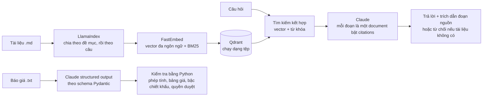

# rag-erp-demo

Demo trợ lý AI cho tài liệu nội bộ kiểu ERP: **hỏi đáp quy trình có trích dẫn**, **trích xuất và kiểm tra báo giá**, và **bộ đo độ chính xác** chạy lại được sau mỗi lần đổi prompt hay cấu hình.

Python · LlamaIndex · Qdrant · FastEmbed · Claude API (Anthropic SDK) · Pydantic · pytest

> Dữ liệu trong `data/` là của một công ty truyền thông **giả lập** (Công ty CP Truyền thông Sao Việt), tự soạn để demo: 6 tài liệu quy trình và 2 báo giá.

## Chạy thử

Cần Python 3.12. Trên Windows nên clone vào một thư mục ngắn, ví dụ `C:\rag-erp-demo`: thư viện Anthropic có tệp tên rất dài, nên nếu đường dẫn quá dài thì Windows báo lỗi lúc cài, trừ khi đã bật Long Path.

Windows (PowerShell):

```powershell
git clone https://github.com/Tay-Tran/rag-erp-demo C:\rag-erp-demo
cd C:\rag-erp-demo
python -m venv .venv
.venv\Scripts\Activate.ps1      # nếu bị chặn: Set-ExecutionPolicy -Scope Process Bypass
pip install -r requirements.txt
copy .env.example .env          # điền ANTHROPIC_API_KEY; bỏ trống thì chạy chế độ phát lại
```

Lần chạy `ingest` đầu tiên tải model embedding (khoảng 300 MB) nên mất vài phút; các lần sau chạy ngay.

macOS/Linux thay hai dòng kích hoạt và chép tệp bằng `source .venv/bin/activate` và `cp .env.example .env`. Sau đó:

```bash
python -m rag_erp ingest                                   # nạp tài liệu vào Qdrant
python -m rag_erp ask "Muốn chiết khấu 20% cho khách thì cần ai duyệt?"
python -m rag_erp extract BG-2026-0157.txt                 # trích xuất + kiểm tra báo giá
python -m rag_erp eval                                     # bộ đo đầy đủ
python -m rag_erp eval --retrieval-only                    # chỉ đo bước tìm kiếm, không tốn tiền
pytest                                                     # 21 unit test, không gọi API
```

## Chạy thử khi không có khóa API

Không có khóa API của Claude vẫn chạy được demo, nhưng màn hình sẽ nói rõ phần nào chạy thật, phần nào là câu trả lời ghi sẵn:

| Phần | Không có khóa API |
| --- | --- |
| Tìm tài liệu liên quan (LlamaIndex, Qdrant, embedding) | Chạy thật trên máy |
| Kiểm tra lỗi báo giá (tính lại, đối chiếu quy định) | Chạy thật trên máy |
| Câu trả lời của Claude, dữ liệu Claude đọc từ báo giá | Phát lại bản ghi từ một lần chạy thật, ghi kèm ngày và model |

- Mỗi lần chạy có khóa, câu trả lời thật được tự động lưu vào `data/replay/`.
- Bản ghi chỉ được phát lại khi câu hỏi, các đoạn tài liệu tìm được, prompt và model giống hệt lúc ghi; khác một chữ là không phát lại. Vì vậy demo không bao giờ đưa câu trả lời của câu này cho câu khác.
- Câu chưa có bản ghi thì demo báo "Chưa có câu trả lời ghi sẵn cho câu hỏi này", liệt kê các câu đã có bản ghi để thử, và vẫn cho xem các đoạn tài liệu tìm được.
- Kết quả phát lại luôn mở đầu bằng dòng "LƯU Ý: Đây là câu trả lời đã ghi lại từ một lần chạy thật với Claude … ngày …". Chi phí và độ trễ hiện ra là số của lần chạy thật lúc ghi.
- Hiện repo **chưa có bản ghi nào** (chưa chạy với khóa API lần nào), nên khi không có khóa chỉ chạy được phần tìm tài liệu, bộ đo tìm kiếm và unit test.
- Muốn ép một chế độ: `RAG_MODE=live` (luôn gọi Claude) hoặc `RAG_MODE=replay` (luôn phát lại).

## Cách hoạt động



| Phần | Tệp | Ghi chú |
| --- | --- | --- |
| Nạp tài liệu | `rag_erp/ingest.py` | `MarkdownNodeParser` giữ đường dẫn đề mục để trích dẫn ghi được "tài liệu › mục"; `SentenceSplitter` cắt đoạn dài |
| Kho vector | `rag_erp/store.py` | Qdrant chế độ tệp (không cần Docker); embedding `paraphrase-multilingual-MiniLM-L12-v2` chạy trên máy, thêm BM25 cho tìm kiếm kết hợp |
| Hỏi đáp | `rag_erp/ask.py` | Dùng tính năng citations của Claude, nên trích dẫn trỏ đúng đoạn văn nguồn thay vì để model tự ghi tên tài liệu |
| Trích xuất | `rag_erp/extract.py`, `schema.py` | `messages.parse` với schema Pydantic; model chép đúng số trên chứng từ, kể cả số sai |
| Kiểm tra chứng từ | `rag_erp/checks.py` | Mọi phép tính và đối chiếu quy định làm bằng Python, không để LLM tính, nên lặp lại được và có unit test |
| Prompt có phiên bản | `rag_erp/prompts.py` | Mỗi prompt có mã phiên bản; mã này đi vào nhật ký chi phí và kết quả đo |
| Ghi và phát lại | `rag_erp/replay.py` | Lưu câu trả lời thật; không có khóa thì phát lại, có nhãn rõ ràng |
| Chi phí, độ trễ | `rag_erp/usage.py` | Mỗi lần gọi ghi token, chi phí USD và độ trễ vào `storage/usage.jsonl` |
| Bộ đo | `rag_erp/evaluate.py`, `data/eval/` | 19 câu trong phạm vi + 2 câu ngoài tài liệu; 2 báo giá có đáp án từng trường và danh sách lỗi cần bắt |

## Kết quả đo

**Bước tìm kiếm** (19 câu hỏi có đáp án nguồn, chạy `eval --retrieval-only`):

| Cấu hình | Tìm đúng tài liệu nguồn |
| --- | --- |
| Chỉ vector, top-3 | 17/19 |
| Chỉ vector, top-4 | 17/19 |
| Chỉ vector, top-5 | 18/19 |
| Vector + BM25, top-3 | 19/19 |
| Vector + BM25, top-4 (mặc định) | 19/19 |

Khi chỉ dùng vector, hai câu trượt:
- "Muốn chiết khấu 20% cho khách thì cần ai duyệt?" bị kéo về quy trình duyệt mua hàng.
- Câu hỏi ghép chiết khấu với đặt cọc chỉ tìm được tài liệu hợp đồng.

Thêm BM25 thì bắt được từ khóa "chiết khấu", nên tìm đủ cả hai.

**Hỏi đáp và trích xuất:** chưa đo, sẽ cập nhật ở đây. Khi chạy `python -m rag_erp eval`, bảng kết quả được ghi vào `results/latest.md`, gồm tỉ lệ trả lời đúng, từ chối đúng, có trích dẫn, độ đúng từng trường của báo giá, độ trễ và chi phí.

## Kiểm tra báo giá bắt được gì

`BG-2026-0157.txt` được soạn sẵn với ba lỗi; bộ kiểm tra phải bắt đủ cả ba:

- Dòng 2: 240 × 1.000.000 đ = 240.000.000 đ, chứng từ ghi 204.000.000 đ.
- Hợp đồng 8 tuần có chiết khấu chuẩn 5%, báo giá ghi 20%.
- Chiết khấu 20% phải được Trưởng phòng Kinh doanh duyệt trên ERP, chứng từ ghi "chưa duyệt".

## Giới hạn

- Dữ liệu nhỏ (6 tài liệu, 29 đoạn); với kho lớn cần Qdrant máy chủ, lọc theo metadata (phòng ban, quyền xem) và bộ đo lớn hơn.
- Chứng từ đầu vào là văn bản; ảnh hoặc PDF scan cần thêm bước OCR, hoặc gửi thẳng ảnh/PDF cho Claude.
- Chấm câu trả lời bằng từ khóa bắt buộc; bộ đo lớn hơn nên thêm chấm bằng LLM có đối chiếu với người chấm.

## Tác giả

Trần Ngọc Tây — [github.com/Tay-Tran](https://github.com/Tay-Tran) · [opener.com.vn](https://opener.com.vn). Mã viết cùng Claude Code; mình thiết kế, soát và kiểm chứng.
